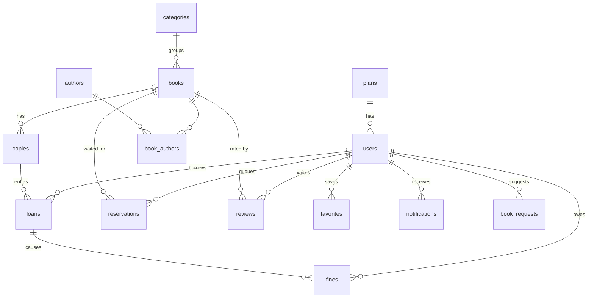

# Athenaeum — Library Management System

A full library system for a Java + DBMS project: catalog, circulation desk, holds queue, fines,
reviews, purchase requests, notifications, dashboards, CSV export and a tamper-evident audit log.

- **Backend:** Java (JDK only — `com.sun.net.httpserver`, JDBC, no frameworks). Compiles for Java 8, runs on 8+.
- **Database:** MySQL 8 (schema, view, triggers and a stored procedure in [`sql/schema.sql`](sql/schema.sql)).
- **Frontend:** one-page app in plain HTML/CSS/JS ([`web/`](web)), dark and light themes, works on phones.

## Run it

1. Start MySQL 8 and note the `root` (or other) password.
2. Put the MySQL JDBC driver in `lib/` — `mysql-connector-j-8.4.0.jar` (not committed; download from dev.mysql.com).
3. Copy `.env.example` to `.env` and set `LMS_DB_PASSWORD` (and `LMS_DB_USER` / `LMS_DB_PORT` if yours differ).
4. Run:

```powershell
powershell -ExecutionPolicy Bypass -File run.ps1
```

Open <http://localhost:8080>. On first start the app creates the database, the tables and demo data
(50 books, 111 copies, 17 accounts, six months of loan history, fines, holds).
`run.ps1` finds a JDK itself (JAVA_HOME, PATH, or the portable JDK 17 in `%TEMP%`).
`run.ps1 -Check` compiles and runs the no-database self-check.

**Demo accounts** (password is `Library@2026` for all of them; the sign-in page shows one-click chips while the admin still has it):

| Role | Email |
|---|---|
| Admin | `admin@library.test` |
| Librarian | `librarian@library.test` |
| Member | `aarav.menon@students.test` (others: `firstname.lastname@students.test`) |

Change the admin password (My library card → Change password) before letting anyone else on your network;
the demo chips disappear automatically once you do. The server listens on `127.0.0.1` only unless you set `LMS_HOST=0.0.0.0`.

## What it does

| Area | Features |
|---|---|
| Catalog | search by title / author / ISBN / publisher, category + availability filters, sort by rating / popularity / newest, generated book covers, related titles |
| Circulation desk (staff) | member typeahead, barcode check-out and check-in, copy preview, condition (OK / damaged / lost) with automatic fines, "ready for pickup" list |
| Rules | plan limits (loans, days, renewals), membership expiry, suspended accounts, fine ceiling that blocks borrowing, overdue items block new loans, no duplicate copy of one book |
| Holds queue | first-come queue when every copy is out; a returned copy is held 72 h for the first member; expiry promotes the next one |
| Renewals | blocked when overdue, at the renewal limit, or when someone is waiting |
| Fines | accrue per day, capped at the book price; pay (simulated) or waive; unpaid fines shown everywhere |
| Reviews | only members who have borrowed the book can review it; star distribution; staff can remove abuse |
| Reading list, requests | favourites; members suggest books, staff approve / decline / mark bought |
| Notifications | loan, return, hold-ready, fine, due-soon and overdue notices (de-duplicated by a unique key) |
| Dashboard (staff) | KPIs, loans per month, categories, busiest weekday, top titles, fines collected, overdue list, live activity |
| Members (staff) | add / edit / suspend / change plan / extend membership, admin-only role changes and password reset |
| Audit & export | hash-chained audit log with one-click verification; CSV export of loans, fines, books, members |
| Library card | printable card with a Code 39 barcode |

## Database design



DBMS concepts used (good headings for a report):

- **Normalisation to 3NF** — plans, categories and authors are separate tables; `book_authors` resolves the many-to-many; a *book* (title) is separate from its physical *copies*.
- **Constraints** — primary/foreign keys with `ON DELETE` rules, `UNIQUE` (ISBN, barcode, card number, one review per member per book), `CHECK` (rating 1–5, `due_at > issued_at`, fine > 0), `ENUM` states.
- **Triggers** — `trg_loans_bi` refuses a loan for a copy that isn't available or for a suspended member; `trg_loans_ai` / `trg_loans_au` keep `copies.status` in step with loans (defence in depth under the Java checks).
- **Views** — `v_book_stats` (availability, rating, popularity per title) and `v_overdue`.
- **Stored procedure** — `sp_purge_sessions`, called by the maintenance job.
- **Transactions and locking** — each desk action is one transaction using `SELECT … FOR UPDATE` on the copy and member rows, so two desks cannot lend the same copy or exceed a member's limit.
- **Indexes** — composite indexes for the hot paths (`copies(book_id,status)`, `loans(user_id,returned_at)`, `reservations(book_id,status)`).
- **Aggregation / windows of time** — dashboard queries group by month, category and weekday (`ONLY_FULL_GROUP_BY` safe).

## Security and ethics notes

- Passwords: PBKDF2-HMAC-SHA256, 120 000 iterations, per-user salt, constant-time compare. **Hashing is for passwords only** — it isn't encryption, and nothing here claims message secrecy.
- Sessions: random 256-bit token; only its SHA-256 is stored; 12 h expiry; password reset signs the member out.
- Login throttling: 5 failures lock that email for 5 minutes. Unknown emails take the same time as wrong passwords.
- Every SQL statement is parameterised; every value shown in the UI is HTML-escaped; CSV export neutralises spreadsheet formulas; strict CSP and `nosniff` headers.
- Roles are enforced on the server: members only ever see their own loans, fines and holds; only admins delete books, create staff or reset passwords.
- Privacy: reviews show names only to signed-in users; the catalog is public but personal data is not. Collect only what the library needs (name, email, optional phone).
- Payments are **simulated** — no card or bank details are ever collected.
- ISBNs in the demo data are generated (valid checksum, not real). Book blurbs are original one-liners.

## Project layout

```
sql/schema.sql            tables, views, triggers, procedure
src/lms/Main.java         start-up: database, schema, seed, HTTP server, background job
src/lms/Http.java         router, static files, error mapping, security headers
src/lms/Api.java          all REST routes
src/lms/Circulation.java  issue / return / renew / holds / fines rules
src/lms/Auth.java         PBKDF2, sessions, login throttle
src/lms/Audit.java        hash-chained audit log
src/lms/Db.java, Json.java  JDBC pool + transactions, JSON reader/writer
src/lms/Seed.java         demo data
src/lms/SelfCheck.java    no-database checks (JSON, hashing, fine rule, audit hash)
web/                      index.html, app.css, app.js
```

Currency is `₹`; change `CUR` in `Circulation.java` and `web/app.js` (and the plan fees in `Seed.java`) for another currency.
